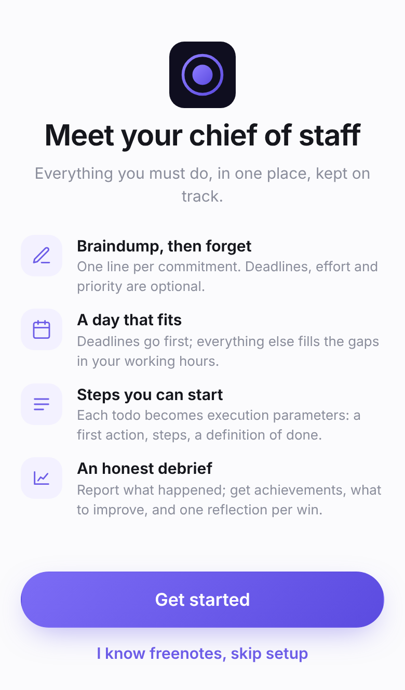
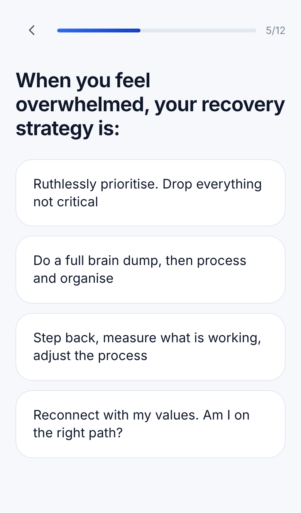
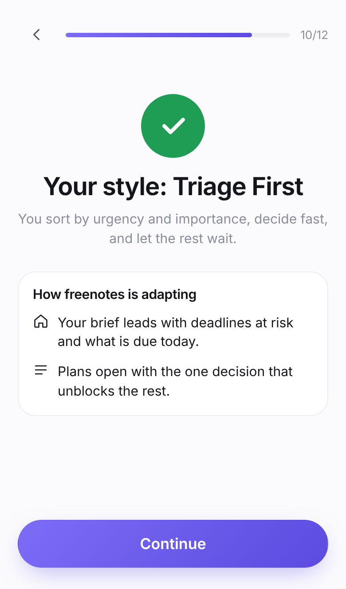
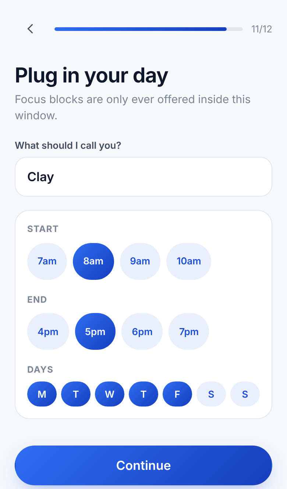
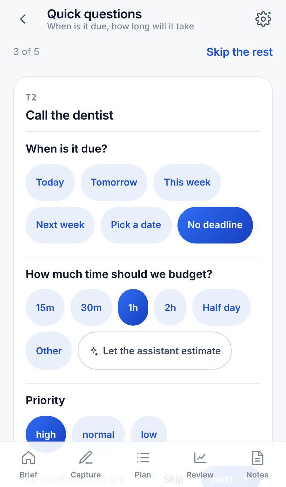
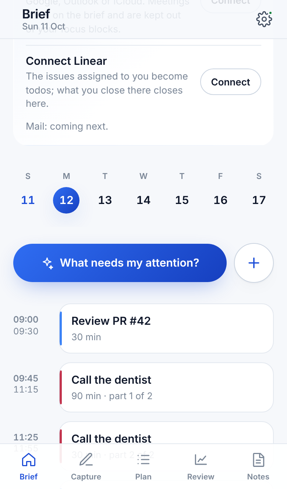
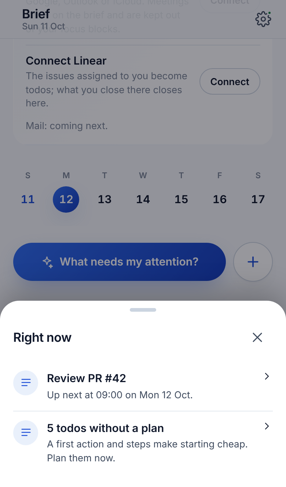
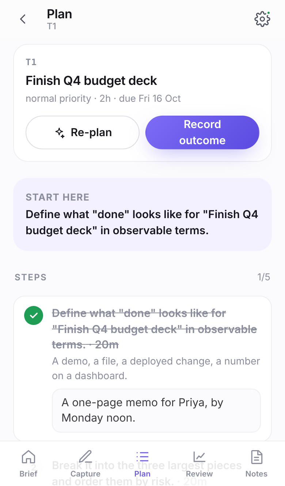
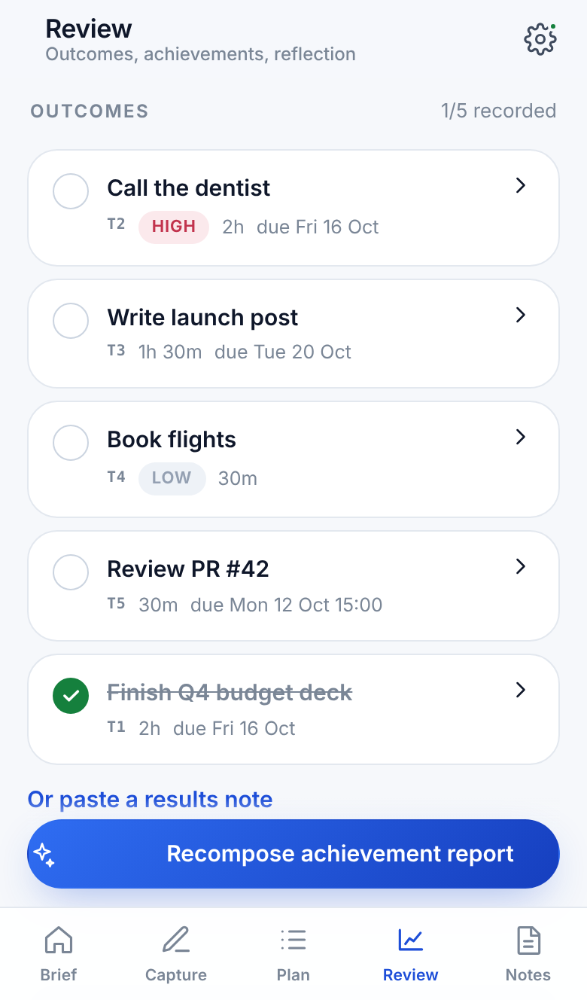

# freenotes

**Notes with a chief of staff.** Braindump what you must do, get a time-blocked schedule, step-by-step execution plans, an achievement report with areas to improve, and a reflection question for everything you finished.

Open source (MIT), local-first, mobile-first, installable as a PWA. Works fully offline with a built-in heuristic assistant; add an Anthropic API key and Claude takes the chief-of-staff seat.

```
braindump ──▶ triage (due? how long?) ──▶ schedule ──▶ execution plans
                                                          │
       reflection ◀── achievement report ◀── results ◀────┘
```

<p align="center">
  
  
  
  
</p>
<p align="center">
  
  
  
  
  
</p>

## First run

A new user is walked in before being asked for anything: meet the chief of staff, try it on one real commitment and watch it get structured live, answer eight quick questions that place you in a working style (triage first, capture everything, measure and adjust, values led, or a hybrid), say what to call you and when you work, and read what the assistant can and cannot do before it acts. The brief and the attention ranking adapt to the style; the whole journey can be re-run from Settings, and a "Get ready" card on the brief lists what is still missing (a model key, an account, and soon calendars, mail and issues).

## The loop

1. **Braindump.** One line per commitment. Optional "by when", effort and priority:
   ```
   - Finish Q4 budget deck by Friday ~2h
   - [high] Call the dentist
   - Write launch post due Oct 20 (1h30m)
   - Book flights !low
   - Review PR #42 by tomorrow 3pm
   ```
   Capture is only capture: nothing is assumed about an item you did not describe.
2. **Triage.** Each captured item gets two quick questions, one card at a time: when is it due (today, this week, a date, or no deadline) and how much time to budget (chips, your own number, or "let the assistant estimate"). Priority too. What you wrote in the braindump is kept and shown as "from your note"; the assistant only estimates when you ask it to.
3. **Schedule.** Deadline items are placed earliest-deadline-first; undated items are fitted into the remaining gaps by priority. Long items are split into focus blocks with breaks. Deadlines that cannot be met are flagged, not hidden.
4. **Plan.** Each todo is decomposed into execution parameters: objective, the literal first action, ordered steps with estimates, a definition of done, inputs to have at hand, and risks. You work the plan inside the app: tick steps off, and when a step asks for a sentence, a list or a decision, write it right there. Nothing has to be written down somewhere else.
5. **Report.** You write a results composition (`T1: done — shipped Thursday`, `T2 partial …`, `T3 blocked on …`), or tap an outcome on the todo. Whatever you wrote while executing is attached to the results note automatically. The chief of staff composes an achievement report: achievements ordered by significance, areas to improve grounded in the evidence, and **one reflection question per completed todo**.
6. **Reflect.** Answer the questions; the answers are kept with the report.

Every artefact is a *composition* (a note), so you can read and search the whole history like any other note.

## Quick start

Requires Node 20+ and [pnpm](https://pnpm.io).

```bash
git clone https://github.com/clayandthepotter/freenotes
cd freenotes
pnpm install
pnpm build
```

### CLI

```bash
alias freenotes="node $PWD/apps/cli/dist/bin.js"

printf -- "- Finish the deck by Friday ~2h\n- Call the dentist\n" | freenotes braindump
freenotes triage T2 --due tomorrow --time 20m        # or --no-deadline, --time assistant
freenotes schedule --days 7 --hours 09:00-17:00 --workdays mon-fri
freenotes plan all
freenotes step T1 1 "A one-page memo for Priya, by Monday noon."   # write a step's answer inline
freenotes step T1 1 --done
echo "T1: done — shipped Thursday. T2 partial, left a voicemail" | freenotes report
freenotes reflect T1 "Starting with the hardest slide made the rest easy."
freenotes notes            # list compositions
freenotes show latest
freenotes --help
```

The workspace is a single JSON file at `./.freenotes/workspace.json` (override with `--workspace` or `FREENOTES_WORKSPACE`). Commit it, sync it, grep it.

### Web app

```bash
export ANTHROPIC_API_KEY=sk-ant-…          # optional; without it the heuristic assistant is used
pnpm --filter @freenotes/server start      # API + serves the built web app on http://localhost:8787
```

For development with hot reload run the server as above and, in another terminal, `pnpm --filter @freenotes/web dev` (Vite proxies `/api` to the server).

The web app stores your workspace in the browser (export/import as JSON from Settings). Only chief-of-staff requests leave the device, and they go to *your* server, so the API key never reaches the browser.

### Deploy to Vercel

The web app and its API deploy as one Vercel project: the Vite build is served statically and `apps/web/api` runs the Hono API as a Vercel Function.

1. Import the repository in Vercel and set **Root Directory** to `apps/web` (`apps/web/vercel.json` supplies the build command).
2. Add `ANTHROPIC_API_KEY` in the project's environment variables; without it the deployment serves the heuristic chief of staff.
3. Optional: `FREENOTES_MODEL`, `FREENOTES_EFFORT`, `FREENOTES_FALLBACKS`.

Any Node host works too: `pnpm build && pnpm --filter @freenotes/server start`.

### Calendars

Connect every calendar you have, work and personal, without OAuth: paste the private ICS address each one publishes (Google: calendar settings → "Secret address in iCal format"; Outlook: Settings → Shared calendars → Publish; iCloud: share as a public calendar). freenotes pulls the feed through its own server (public https hosts only, nothing stored but the events in view), shows meetings on the brief's timeline with the calendar's colour, counts them in the day's read, flags the next one in "What needs my attention", and keeps focus blocks out of their way when it builds the schedule. Feeds refresh every fifteen minutes while the app is open, or on demand.

```bash
freenotes calendar add "webcal://calendar.google.com/calendar/ical/…/basic.ics" "Work"
freenotes calendar sync
freenotes calendar          # list
```

### People

From the same calendars, freenotes reads who you actually meet (meetings of up to six people), how often, when you last and next see them, and flags anyone going cold with nothing scheduled. It shows on the brief and in "What needs my attention". Nothing is stored.

### Issues from Linear

Connect Linear with a personal API key (Settings → Security & access) and pull the issues assigned to you: each becomes a todo with its due date, estimate (points become hours) and priority, linked back to the issue. Pull again any time; issues you complete or cancel in Linear close their todos here. Nothing is written to Linear. Signed in, the key is stored encrypted on the server; otherwise it stays in the browser.

```bash
LINEAR_API_KEY=lin_api_… freenotes linear import
```

### Accounts and bring your own key

Optional. With a Supabase project configured, users can sign in (magic-link email), sync their workspace across devices, and choose their own model provider and API key in Settings: Anthropic, OpenAI, or any OpenAI-compatible endpoint (Groq, Mistral, OpenRouter, a self-hosted Ollama). Keys are encrypted on the server with `FREENOTES_KEY_SECRET` and never sent back to the browser. Without an account the app stays local-first, exactly as before.

Set up:

1. Create a Supabase project and apply the schema in [`supabase/migrations`](supabase/migrations) (tables `workspaces` and `user_settings`, both with row-level security).
2. In Supabase → Authentication → URL configuration, set the Site URL to your deployment (and add `http://localhost:5173` for development) so magic links redirect correctly.
3. Set `SUPABASE_URL`, `SUPABASE_PUBLISHABLE_KEY` and `FREENOTES_KEY_SECRET` on the server, and `VITE_SUPABASE_URL` / `VITE_SUPABASE_PUBLISHABLE_KEY` for the web build. No service-role key is needed anywhere.

See [ADR 0004](docs/adr/0004-accounts-and-bring-your-own-key.md) for the design.

### Using Claude

| Variable | Meaning | Default |
|---|---|---|
| `ANTHROPIC_API_KEY` | Enables the Claude chief of staff (an `ant auth login` profile also works) | – |
| `FREENOTES_AI` | `auto`, `claude` or `heuristic` | `auto` |
| `FREENOTES_MODEL` | Claude model id | `claude-opus-5-5` |
| `FREENOTES_EFFORT` | `low` · `medium` · `high` · `xhigh` · `max` | `high` |
| `FREENOTES_FALLBACKS` | `false` disables server-side refusal fallbacks | `true` |
| `FREENOTES_PROFILE` | A sentence or two about you, sent with every request | – |
| `PORT` | Server port | `8787` |

Requests use structured outputs, so the model's answers are validated against the domain's own rules before they are stored (for example: every completed todo must get exactly one reflection question, phrased as a question).

## Architecture

A pnpm monorepo organised around a domain model; see [`docs/architecture.md`](docs/architecture.md) and the ADRs in [`docs/adr`](docs/adr).

| Package | What it is |
|---|---|
| `@freenotes/core` | The domain and application layer. Zero runtime dependencies; runs in Node and browsers. Parsers, scheduler, use cases, markdown renderers, the `ChiefOfStaff` port, a heuristic implementation, an in-memory repository. |
| `@freenotes/ai-structured` | Provider-neutral base for model adapters: schemas, prompts, domain mapping. |
| `@freenotes/ai-anthropic` | Claude adapter via `@anthropic-ai/sdk` structured outputs. |
| `@freenotes/ai-openai` | OpenAI-compatible adapter (OpenAI, Groq, Mistral, OpenRouter, Ollama, …). |
| `@freenotes/api` | The Hono API: provider registry, per-user assistant resolution, encrypted settings, account routes, the calendar feed proxy. |
| `@freenotes/source-linear` | Linear as an issue source: the issues assigned to you over GraphQL, read-only. |
| `@freenotes/supabase` | Supabase adapters: JWT authenticator, RLS-scoped settings, revisioned workspace sync. |
| `@freenotes/ai-http` | Wire protocol, `fetch` client and framework-agnostic handlers for putting a chief of staff behind HTTP. |
| `@freenotes/storage-fs` | Atomic JSON-file `WorkspaceRepository`. |
| `freenotes` (`apps/cli`) | The command line. |
| `@freenotes/server` (`apps/server`) | Node host for the API + static web app. |
| `@freenotes/web` (`apps/web`) | Vite + React app, local-first. |

## Development

```bash
pnpm test          # vitest, all packages (TZ=UTC for deterministic dates)
pnpm typecheck     # strict TypeScript everywhere
pnpm build
pnpm verify        # build + typecheck + test, what GitHub Actions runs
```

Tests come first: the scheduler, parsers and use cases are specified by their tests, and both chief-of-staff implementations must satisfy the same domain validators. See [CONTRIBUTING.md](CONTRIBUTING.md).

## Status

Early. The loop works end to end in the CLI and the web app. Ideas on the table: calendar import for busy blocks, recurring braindumps, multiple workspaces, a mobile layout pass, and a richer notes editor. Issues and PRs welcome.

## License

MIT
